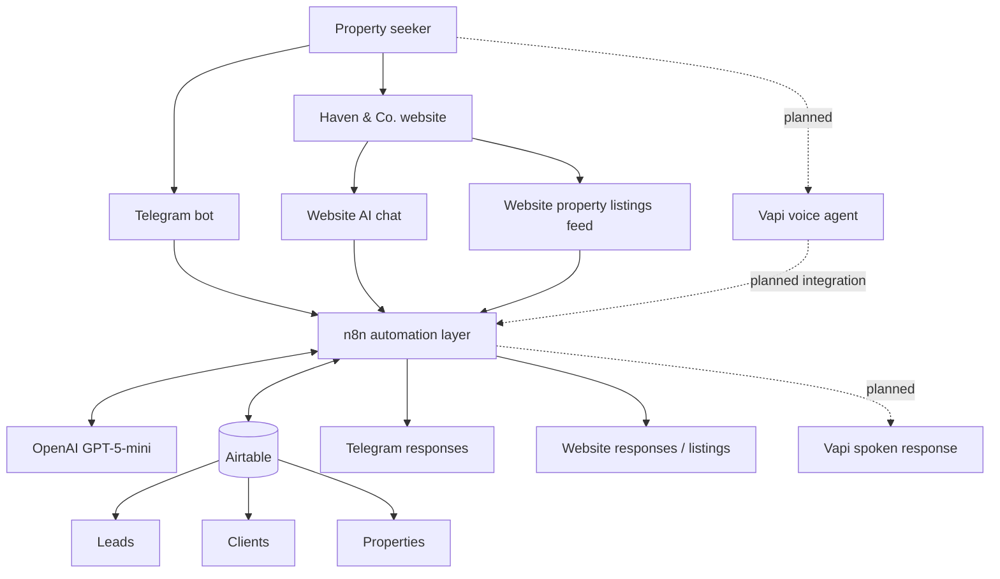

# Haven & Co. — Real Estate Automation

**PROPERTY · PEOPLE · POSSIBILITIES**  
*Exceptional spaces. A more personal way to find yours.*

Haven & Co. is a real-estate discovery and lead-management project designed to help property seekers find suitable homes through conversational channels, while giving the business a structured way to manage property information and enquiries.

> **Project status:** Active portfolio project. Some components have been built; others remain under configuration or require further validation. This repository distinguishes implemented work from planned or unverified work.

## Project goals
- Accept natural-language property searches.
- Extract budget, location, property type and room preferences.
- Search available listings and return details, images and prices.
- Support Telegram and the Haven & Co. website.
- Keep property, lead and client information in Airtable.
- Extend the experience to voice.

## Brand
- **Brand:** Haven & Co.
- **Tagline:** PROPERTY · PEOPLE · POSSIBILITIES
- **Brand statement:** Exceptional spaces. A more personal way to find yours.
- **Personality:** Premium, welcoming, trustworthy, refined, intelligent and human.
- **Initial market:** Nigeria.
- **Audience:** Property seekers, property owners and agents.

| Token | Colour |
|---|---|
| Forest green | `#102D28` |
| Warm ivory | `#F7F4ED` |
| Muted gold | `#D7B77A` |
| White | `#FFFFFF` |
| Charcoal green | `#26332F` |

## Technology
Antigravity (website) · n8n (automation) · Airtable (data) · Telegram Bot (messaging) · OpenAI GPT-5-mini (language model) · Vapi (planned voice interface).

## Repository guide
- [Documentation](documentation/README.md)
- [Telegram property search](workflows/01-telegram-property-search/README.md)
- [Website AI chat](workflows/02-website-ai-chat/README.md)
- [Website property feed](workflows/03-website-property-feed/README.md)
- [Vapi voice agent](workflows/04-vapi-voice-agent/README.md)
- [Assets guide](assets/README.md)
- [System organogram](diagrams/system-organogram.md)

Each workflow keeps its own explanation, n8n export location and screenshots together.

## Current status
| Component | Status |
|---|---|
| Airtable Leads, Clients and Properties | Created; verify live field names |
| Telegram property search and lead paths | Built; regression testing recommended |
| Website AI chat | Configured; end-to-end validation required |
| Website property feed | Implemented/design documented; live feed and image mapping need validation |
| Vapi voice agent | Partially designed; assistant setup and website embedding outstanding |

See [testing and limitations](documentation/05-testing-and-limitations.md). A folder or placeholder is not proof that a feature is production-ready.

## Build sequence
1. Define product, audience and brand.
2. Create Airtable tables for Leads, Clients and Properties.
3. Build Telegram search, matching and lead capture.
4. Connect the Antigravity website to n8n.
5. Expose available listings through a website webhook.
6. Prepare the Vapi voice integration.
7. Test, document and improve all channels.

## Setup
Start with [Airtable database](documentation/03-airtable-database.md) and [setup and configuration](documentation/04-setup-and-configuration.md). The workflow export directories are placeholders until actual sanitised n8n exports are added.

## Security
Never commit API keys, tokens, passwords, private webhook URLs, credential exports or personal customer data. Sanitise n8n exports and use fictional/demo data in public screenshots. Confirm image rights before publishing property photos.

## Evidence
Screenshots belong inside the `screenshots/` directory of the workflow they document. Add real evidence only; redact private information.

---

## System organogram

The diagram shows the intended architecture. The Vapi path is marked planned because assistant configuration and website embedding are not confirmed complete.



**Architecture principle:** n8n coordinates automation; Airtable stores operational records; Telegram, the website and the future voice agent are user-facing interfaces.

---

## 📁 Repository Structure

```text
│
├── README.md
│
├── assets/
│   ├── README.md
│   ├── haven-co-logo.png
│   ├── website-homepage.png
│   └── property-listing-example.png
│
├── diagrams/
│   ├── system-organogram.md
│   ├── telegram-workflow.md
│   ├── website-workflow.md
│   └── voice-agent-workflow.md
│
├── documentation/
│   ├── 01-project-overview.md
│   ├── 02-system-architecture.md
│   ├── 03-airtable-database.md
│   ├── 04-setup-and-configuration.md
│   └── 05-testing-and-limitations.md
│
└── workflows/
    ├── 01-telegram-property-search/
    │   ├── README.md
    │   ├── workflow-export/
    │   │   └── telegram-property-search.json
    │   └── screenshots/
```
