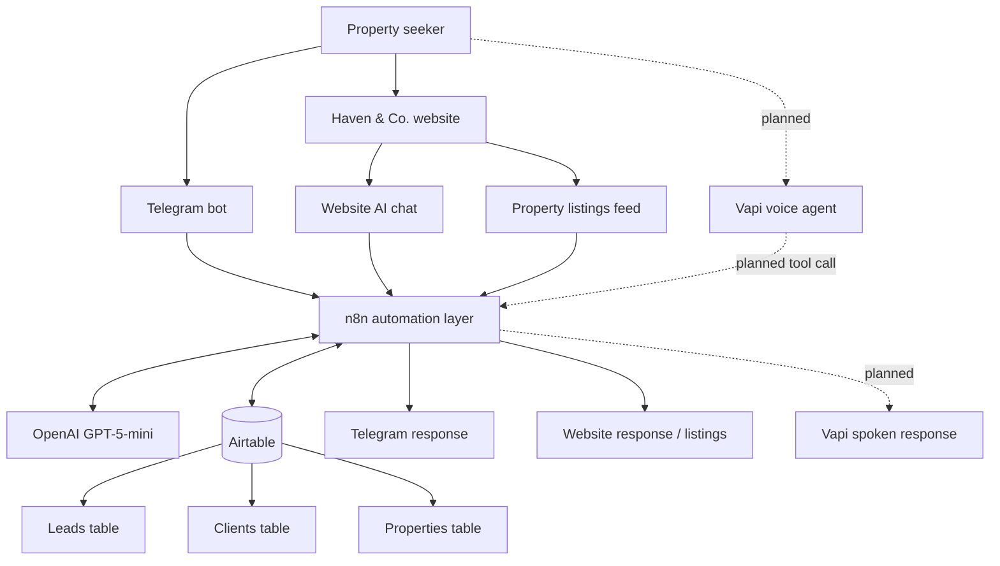

# Haven & Co. system organogram

This is the high-level intended architecture. The Vapi connection is marked as planned because the assistant configuration and website embed are not yet confirmed complete.

## Responsibility split

- **Antigravity website:** user-facing web experience.
- **Telegram:** messaging-based property search.
- **Vapi:** intended voice interface.
- **n8n:** orchestration, AI steps, matching logic and API/webhook handling.
- **OpenAI:** language understanding and response generation in configured AI nodes.
- **Airtable:** operational records for properties, leads and clients.
