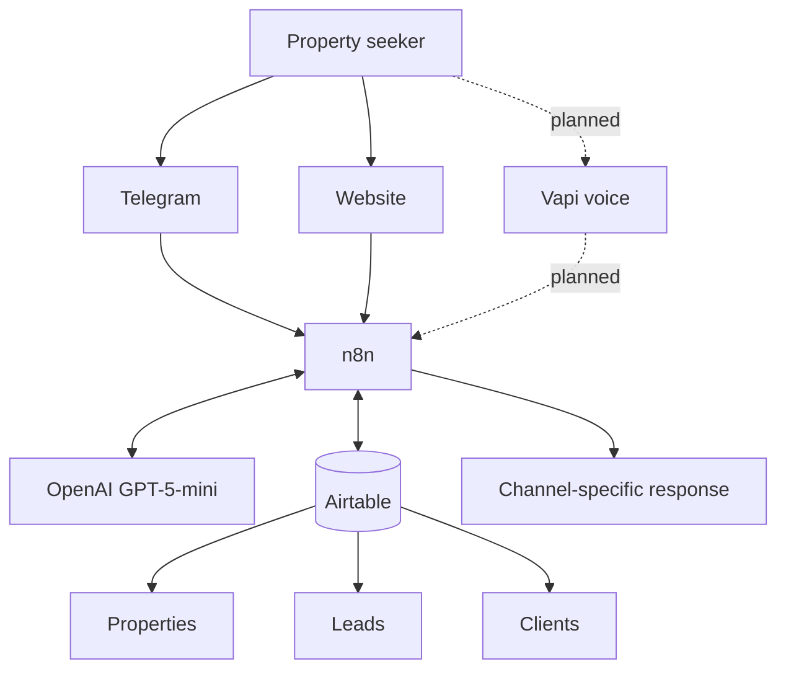

# 02 — System architecture

## Layers
- **Channels:** Telegram bot, Haven & Co. website and planned Vapi voice agent.
- **Orchestration:** n8n workflows and webhooks.
- **Language understanding:** OpenAI GPT-5-mini in configured AI steps.
- **Data:** Airtable base with Leads, Clients and Properties tables.

## Logical architecture

## Workflow responsibilities
| Workflow | Responsibility |
|---|---|
| Telegram property search | Interpret requests, find/rank listings, reply and support lead capture |
| Website AI chat | Conversational website interface and listing queries |
| Website property feed | Return available property records as JSON |
| Vapi voice agent | Planned voice interface calling n8n for property lookup |

## Data flow
1. A channel receives a request.
2. n8n validates and interprets it.
3. An AI step may convert natural language into structured criteria.
4. n8n queries Airtable.
5. Matching logic selects and formats results.
6. The channel receives a response.
7. Where configured, lead information is created or updated.

## Channel neutrality
Use Lead Source to identify the origin of an enquiry. The data model should not assume all leads originate from Telegram. Telegram Chat ID is channel-specific and should not be treated as a universal identifier.

## Operational boundaries
Airtable is the operational data store in this project. Review scale, permissions, rate limits and reliability before treating it as a production database. n8n is the orchestration layer, not the public frontend. Browser-facing endpoints should return only required fields.

## Status
Telegram and the website property-feed paths have been developed. Website chat needs validation. Vapi integration is incomplete.
